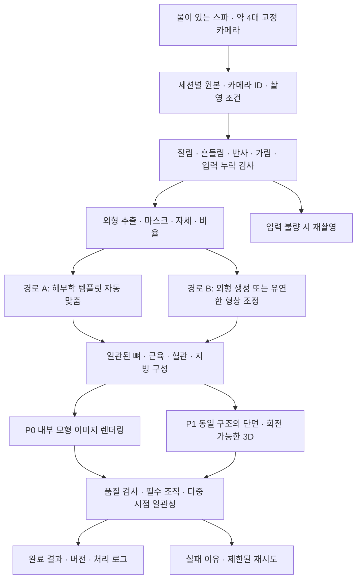

# 촬영 → 사진 처리 → 내부 모형 → 출력

이 문서는 [현행 PRD](./스파_내부모형_이미지생성_PRD.md)의 탐색 경로를 안내한다. 아래 흐름은 설계이며 실행 구현·성능 검증을 완료한 상태가 아니다. 충돌 시 현행 PRD를 우선한다.

## 단계별 근거와 미완료 작업

| 단계 | 보관 문서 | 구현 전 확인할 것 |
|---|---|---|
| 장치·촬영 | [기기 조사](./스파_건강시각화_기기스펙_및_오픈소스_조사.md), [촬영·표시 조사](./outputs/research_capture_display_20261030.md) | 실제 통 치수·수위·온도·창·조명·카메라 보정 |
| 입력 검사·외형 | [PRD](./스파_내부모형_이미지생성_PRD.md), [표면 3D 조사](./outputs/research_surface_3d_20261030.md) | 실제 물·하우징 입력에서 윤곽·자세·비율 확보 |
| 모델·내부 구성 | [해부학 자산 조사](./outputs/research_anatomy_20261030.md), [생성 기술 조사](./outputs/research_generation_20261030.md) | 사용할 조직 자산 확인, 경로 A/B 품질 비교, 자동 정렬 실증 |
| 렌더링·3D | [오픈소스 종합 조사](./outputs/스파_신체시각화_오픈소스_조사_20261030.md), [PRD](./스파_내부모형_이미지생성_PRD.md) | 필수 조직과 외형의 연결, 단면 채움, 시점 일관성 |
| 품질·자동화 | [PRD G0~G4](./스파_내부모형_이미지생성_PRD.md) | 목표·탈락 각 3장 기준 세트, 대표 입력 실증, 초기 6세트 검증 |

원본·전처리·중간 모델·최종 결과·로그를 세션별로 분리하고 원본을 보존한다. 각 결과에 모델·템플릿·설정 버전을 남기는 것이 요구사항이다. 파일 형식·의존성 버전·배포 환경은 아직 고정되지 않았다.

`rembg`, Real-ESRGAN, BodyParts3D, Blender 등은 조사 후보다. `archives/`의 과거 채택안을 현재 확정 모델로 취급하지 않는다. 이미지 품질과 뼈·근육·혈관·지방 표현을 검증한 뒤 확정한다.

다음 착수 지점은 G0 기준 이미지 세트와 대표 입력 1세트의 출력 실증이다. 상세 조건·가정·판정 기준은 PRD에서 확인한다.
